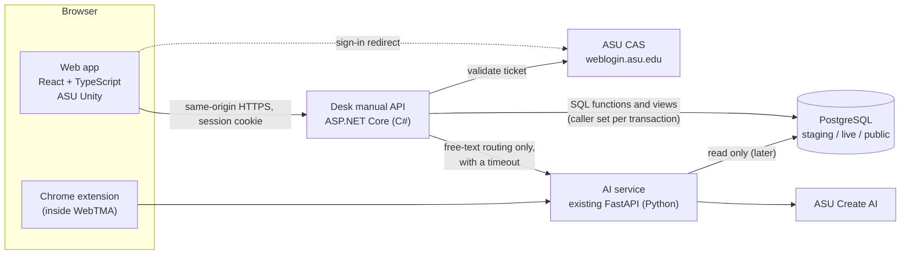

# Desk manual web app: system plan

Status: draft for review. No app code exists yet. The database (`db/`) is built and tested; this plan is the layer on top of it.

Stack, as ASU builds it: **React** front end, **C# / ASP.NET Core** back end, **ASU CAS** sign-in. The database stays **PostgreSQL** with the schema in `db/schema.sql`.

Scope is the 29 Musts from the user stories. The Shoulds and Coulds wait.

## 1. The pieces



| Piece | What it does | Status |
|---|---|---|
| Web app (React) | Every screen in the mockups: dispatch, manual, lookups, editor, review, releases, admin, import check | New |
| Desk manual API (C#) | Sign-in, sessions, rights, and every read and write. Thin: the rules live in the database | New |
| PostgreSQL | Data, peer review, two-person publish, rollback, logs. Already enforces the rules | Built, 68 checks pass |
| AI service (Python) | Turns a pasted email or a free-text request into a task suggestion | Exists today (`backend/`) |
| Chrome extension | The assistant inside WebTMA | Exists today, unchanged in v1 |
| Import tools (Python) | One-time load from the workbook (`db/setup.py`) | Built, run on the real workbook |

### Why the AI service stays in Python for v1

It is already built, tested (`backend/tests`) and measured (`backend/eval_model.py`). Porting it to C# adds risk and no new behaviour. The C# API calls it with a short timeout. If it is slow or down, the app still answers from the structured lookups, which is the Must "lookups keep working when the AI is down". Porting it later stays possible, because only the API talks to it.

## 2. Sign-in (CAS) and sessions

1. Someone opens the app without a session. The API redirects to `https://weblogin.asu.edu/cas/login?service=<app>/auth/callback`.
2. CAS sends them back with a one-time ticket. The API checks it server to server (CAS 3.0 `serviceValidate`) and gets the ASURITE.
3. The API calls `ensure_user(asurite, display_name)`. A first-time user becomes a **viewer**. A manager grants more with `set_role`, which is logged (story 7.3).
4. The API issues its own session cookie: HttpOnly, Secure, SameSite=Lax, a working-day lifetime. No tokens in browser storage.
5. Sign-out clears the cookie and sends the person to CAS logout.

The web app and API are served from **one origin**, so there is no CORS and the cookie just works. POSTs carry an anti-forgery header.

**Before real CAS works**, ASU has to register the app's service URL. Until then, development uses a stand-in login that exists only in the Development environment and refuses to start anywhere else.

## 3. How the API talks to the database

- **Npgsql + Dapper**, calling the SQL functions and views directly. No Entity Framework migrations: `db/schema.sql` owns the schema.
- Every request runs in one transaction that starts with `SELECT set_config('app.asurite', @asurite, true)`. The database's `me()` reads the caller from there, so the rules (no self-approval, two approvers, rights) hold even if the API has a bug.
- Two connection pools:
  - **reader** (member of `deskmanual_reader`): live data only. Used by dispatch and lookups.
  - **app** (member of `deskmanual_app`): staging, change requests, releases. Used by editing and admin.
- Database errors raised by the rules (for example "you can't approve your own request") come back to the screen as plain messages, not 500s.

## 4. What v1 builds, Must by Must

| Must | API | Database (exists) | Screen (mockup) |
|---|---|---|---|
| Route a request: code, trade, campus, priority | `GET /api/dispatch/route?task&building&campus` | `live.routing_lookup`, `live.building_lookup` | Dispatch |
| Call-out yes/no with the reason, routing trail | same response: the rule used, notes, General Notes | routing rule `kind`, task and section notes, General Notes article | Dispatch |
| Emergency alert first | flag in the response when the task or notes say emergency | section notes (for example Lock Shop's critical line) | Dispatch, top banner |
| Pasted emails handled like calls | `POST /api/dispatch/from-text` (calls the AI service; caller details never stored) | none | Dispatch |
| Search the manual | `GET /api/manual/search?q` | `live.article`, tasks, buildings | Manual |
| Zone plus who's on call | `GET /api/lookups/zone/{code}` | `live.who_to_call` | Lookups |
| Flag a mistake (WO number required) | `POST /api/flags` | `flag_entry` | Manual, Dispatch |
| Start from the trade | `GET /api/lookups/trade/{code}` | routing + contacts | Lookups |
| Who's covering now, backup, cell number first, one-click copy | `GET /api/lookups/who?target` | `live.who_to_call` (rotations, cell first) | Lookups (desktop and mobile) |
| Lookups work when the AI is down | lookups never call the AI | none | none |
| Add and edit entries | `POST /api/changes`, `POST /api/change-sets` | `submit_change`, `submit_change_set` | Editor, Entry |
| Review others' requests, never your own | `POST /api/changes/{id}/approve or deny` | `approve_change`, `deny_change` (refuses your own) | Editor (review queue) |
| See dispatcher flags | `GET /api/flags` | `manual_flag` | Editor |
| Publish with a second approver | `POST /api/releases`, `POST /api/releases/{id}/confirm` | `request_publish`, `confirm_release` | Admin (releases) |
| Roll back, keep every version | `POST /api/releases/rollback` | `request_rollback`, snapshots | Admin (releases) |
| ASURITE/CAS sign-in | `/auth/login`, `/auth/callback`, `/auth/logout` | `ensure_user` | Sign-in |
| Manager grants and removes rights | `PUT /api/users/{asurite}` | `set_role`, `role_change` | Admin (people) |
| Locked activity log | `GET /api/activity` | `public.activity`, append-only logs | Admin |
| Beta feedback: optional rating, per-part corrections | `POST /api/feedback` | **not built yet** | Dispatch (after an answer) |
| Routing imported first, side-by-side review, Excel stays | `GET /api/import`, `POST /api/import/{sheet}/review` | `import_sheet`, `review_import` | Import check |

Already settled and carried through: caller details are never stored, low-confidence results show options, Lookups work on mobile, and BFIT's security review happens before launch.

## 5. Gaps to close before or during the build

1. **Contacts and on-call data are not loaded.** The tables and `who_to_call` exist; nothing fills them. The source is the workbook's contact sheets, which are free text. This blocks the "who's covering" Musts and is the biggest unknown.
2. **Beta feedback tables** don't exist yet. Small.
3. **Emergency detection** needs a rule: which tasks or notes count as an emergency. Needs a decision from the desk.
4. **Source data fixes** (see the to-do list): buildings with no campus, two tasks that route nowhere, Tempe residential buildings with no RFMT zone.
5. **This branch is 6 commits behind `main`.** Merge before starting.

## 6. Code layout (proposed)

```
api/      ASP.NET Core Web API (C#), plus api.Tests
web/      React + TypeScript (Vite), ASU Unity components
db/       schema, importers, rule tests, lookup preview (exists)
backend/  AI service, FastAPI (exists)
```

In production the API serves the built `web/` files, which keeps one origin.

## 7. Environments and security

| Environment | Database | Sign-in | Who |
|---|---|---|---|
| Local | the throwaway Postgres | stand-in login | developers |
| Staging | a copy, refreshed from production | ASU CAS (test registration) | testers, BFIT review |
| Production | the real database | ASU CAS | the desk |

- Secrets (database passwords, AI keys) come from the host's secret store, never from the repo.
- Staff contact details stay in the database and are only shown to signed-in users.
- Logs record who did what, never caller details or pasted email text.

## 8. Build order

| Phase | Delivers | Done when |
|---|---|---|
| 0. Groundwork | Merge `main`; scaffold `api/` and `web/`; stand-in login; health check | App starts locally and shows the signed-in ASURITE |
| 1. Dispatch + Lookups (read only) | Route a request, notes and General Notes, building zones, manual search, flag a mistake | Answers match the lookup preview on the answer-key calls |
| 2. Contacts | Load contacts and rotations; who's covering, backup, cell first, copy | A desk lead confirms on-call for every zone |
| 3. Editing and review | Add and edit, change sets, review queue, flags inbox | A request goes from submit to approve without the database refusing anything valid |
| 4. Releases | Publish with two approvers, roll back, version history | A test release and rollback on staging |
| 5. Access and audit | Real CAS, manager rights screen, activity log | BFIT security review passed |
| 6. Pasted email + beta feedback | AI routing from text; ratings and corrections | Beta testers using it next to the Excel |
| 7. Migration sign-off | Side-by-side import review | Every sheet marked reviewed; Excel retired |

## 9. Decisions needed

| Decision | Options | Who |
|---|---|---|
| Hosting | ASU's AWS or Azure accounts, or Enterprise Technology hosting | BFIT |
| CAS registration | Service URLs for staging and production | ASU identity team |
| .NET version | The LTS release your team standardises on | Team |
| Repo | Keep in this repo (`api/`, `web/`) or a new ASU repo | You or the team |
| Emergency rule | What counts as an emergency for the alert-first banner | The desk |
| Contacts source | Which contact sheets are the truth for on-call | The desk |
